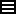
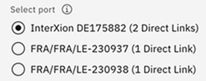

---

copyright:
  years: 2017, 2026
lastupdated: "2026-05-08"

keywords:

subcollection: direct-link

---

{{site.data.keyword.attribute-definition-list}}

# Ordering Direct Link Exchange on Classic
{: #how-to-order-ibm-cloud-direct-link-exchange}
{: help}
{: support}

As you prepare to order Direct Link on Classic, review the general process that your organization follows for obtaining the Exchange service, including the locations where each service is available, globally. When you're ready to place your order, follow the step-by-step instructions.
{: shortdesc}

To determine which Direct Link solution is best for your networking environment, see
[How do I know which type of IBM Cloud Direct Link I need?](/docs/direct-link?topic=direct-link-get-started-with-ibm-cloud-direct-link#get-started-solution-to-order)
{: tip}

## Direct Link ordering process overview
{: #ordering-process-overview-exchange}

Here is the general process to order a Direct Link service:

1. Verify your network provider's capabilities to reach the appropriate {{site.data.keyword.cloud_notm}} PoP.
2. Use the [IBM Cloud console ](/login) to open a Direct Link Exchange request and complete the requested information. You can request assistance from IBM Cloud Sales engineers. When you are ready to create your order, you are prompted to read and agree to the [Direct Link Exchange prerequisites](/docs/direct-link?topic=direct-link-ibm-cloud-dl-exchange-prereqs).

3. Contact your Exchange provider and negotiate connectivity to your colocation.
4. Order a virtual circuit through the Exchange provider, and reference the case ID of the {{site.data.keyword.cloud_notm}} Direct Link request as your Request ID or Authorization ID.

IP assignment on the {{site.data.keyword.cloud_notm}} networking infrastructure is completed within three business days after the virtual circuit request is complete.

## Ordering instructions
{: #how-to-order-cloud-exchange}

To provision an IBM Cloud Direct Link Exchange connection, complete the following steps:

1. Log in to your [IBM Cloud console](/login){: external} account.
1. Select the **Navigation Menu** icon  on the upper left, then click **Classic Infrastructure** > **Direct Link**.

   The Direct Link on Classic page opens, listing existing Direct Link connections provisioned for this account.

1. Click **Order Direct Link** in the upper right of the page. The Choose Direct Link option page is displayed.
1. Select the **Direct Link Exchange** tile to open the order form.

   Optionally, if diverse ports are accessible, and you previously provisioned the first virtual circuit, you see a page similar to the following one, which shows two ports from which you can select your second virtual circuit. For example:  /n
   {: caption="Virtual circuit selection" caption-side="bottom"}
   {: note}

1. In the order form, complete following information to configure Direct Link Exchange:

   * Enter a Direct Link instance name.
   * Choose the location in which you want to establish the IBM Cloud Direct Link connection.
   * Select the name of your network provider.
   - Select the routing option required for the connection: **Local routing (free)** or **Global routing**.
   * Enter a BGP ASN number from the range given in the information box for the BGP exchanges.

   As you complete these values, you can see an approximate monthly charge in the right Summary pane.

1. Read and agree to the [Direct Link Exchange prerequisites](/docs/direct-link?topic=direct-link-ibm-cloud-dl-exchange-prereqs). Then, click **Create** to complete your order.

   After you complete your order, an IBM Support case number is generated. Click the case number to view case details.

1. After you provision your direct link, see [Configuring Direct Link on Classic](/docs/direct-link?topic=direct-link-configure-ibm-cloud-direct-link) to configure your subnet to interact with IBM Cloud.

## Ordering Direct Link Exchange on Classic when there is no VRF present
{: #how-to-order-exchange-when-there-is-no-vrf-present}

For the accounts with no Virtual Routing and Forwarding (VRF) present, the **Select VRF** field is not displayed in the order form. In this situation, an IBM Support case is generated after you place your order. The case number and details are shown in the IBM Cloud console after you place the order.
{: shortdesc}

## Locations
{: #exchange-locations}

 This table shows which {{site.data.keyword.cloud_notm}} data centers offer Direct Link Exchange connectivity:

| Exchange Provider	| IBM Data Center Code |
|-------------|-----------------------|
| AT Tokyo | Tokyo 2 |
| Ascenty | Sao Paulo 5 |
| Cologix | Montreal 2, Toronto 2 |
| Cyrus One | Dallas 13 |
| DE-CIX | Frankfurt 3 |
| KINX	| Seoul 2 |
| NextDC | Melbourne 2, Sydney 3 |
{: caption="Data centers that offer Direct Link Exchange connectivity" caption-side="bottom"}

* NYC02 and NYC03 connect to the IBM Cloud backbone through NYC1. The primary reason for these PoPs is to extend connectivity to different site providers from our NYC01 site. When planning your diversity strategy, keep in mind that traffic for NYC02 and NYC03 have a single, shared path to the IBM network.
